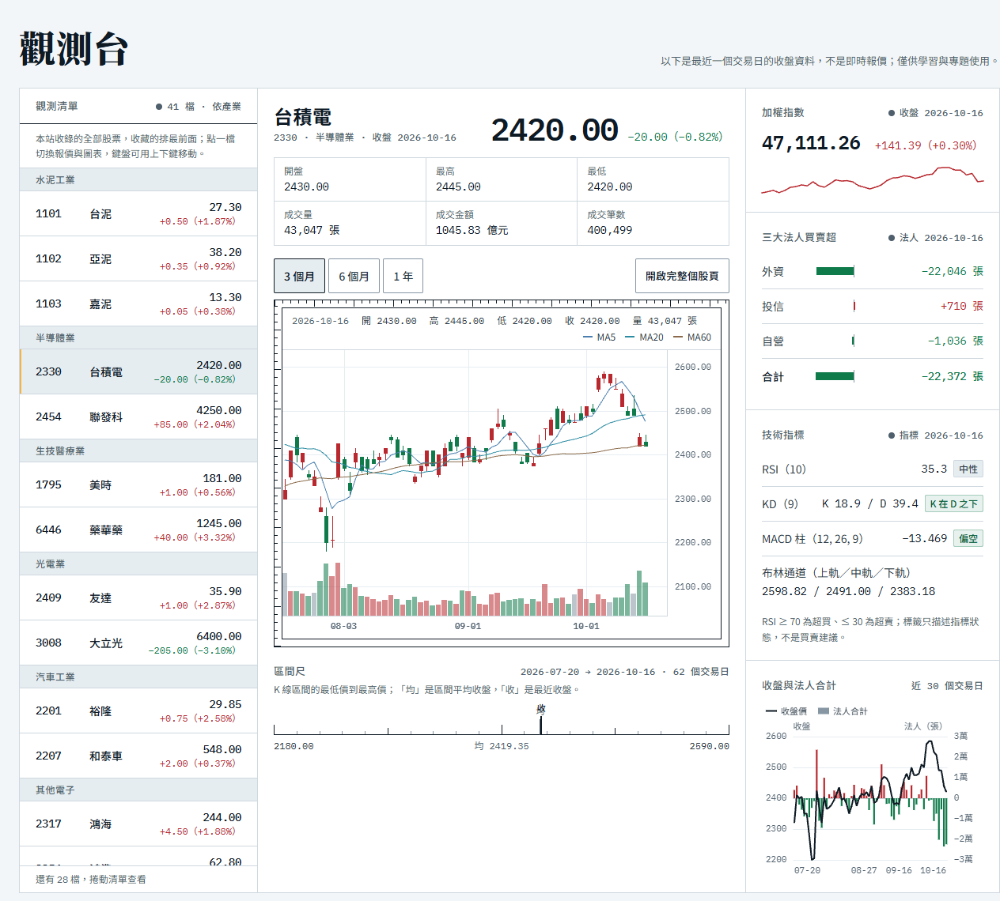
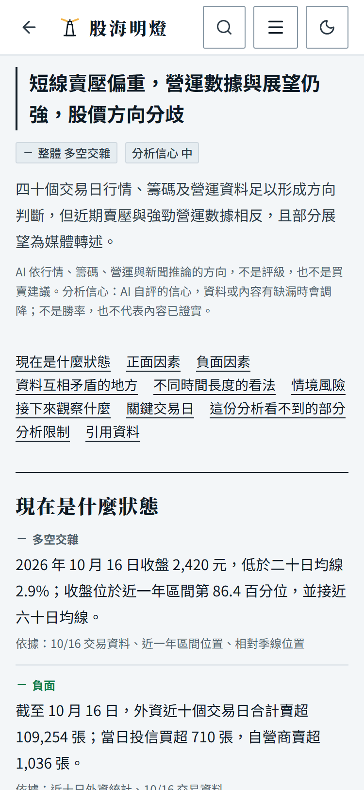
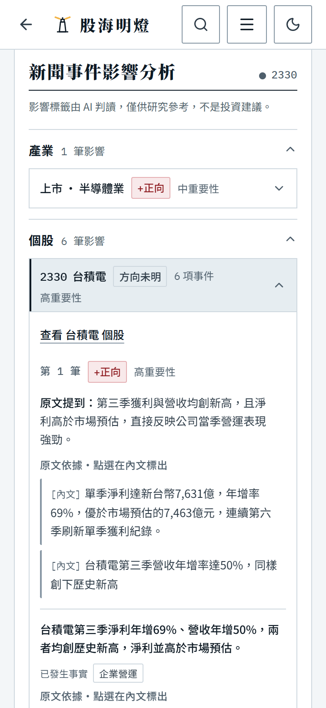
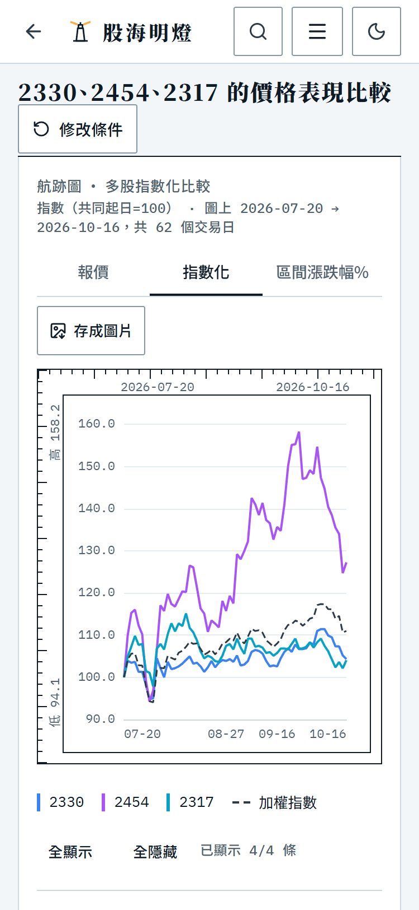
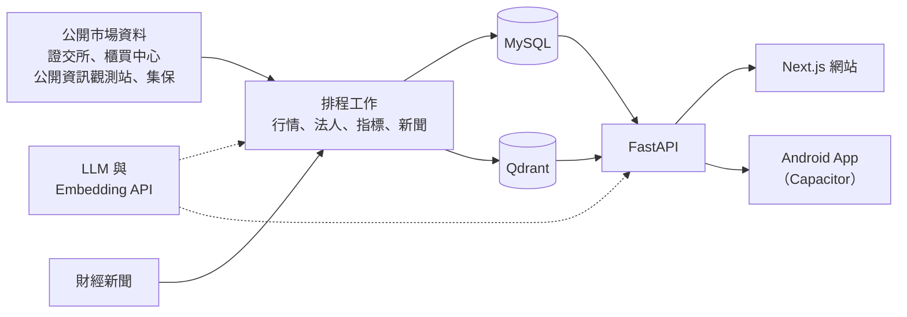

  

<h1 align="center">股海明燈 Stock Lighthouse</h1>

可查證的台股 AI 分析平台：AI 分析附上依據與原文，判斷到期後公開回顧

  
  
  
  
  

  <a href="https://stock-lighthouse.com"><strong>線上版</strong></a> ·
  <a href="docs/development.md"><strong>開發文件</strong></a>

## 核心理念

不比誰猜得準，而是讓每個判斷都能查證。

- **判斷附依據**：AI 分析報告的每一項都標出依據，例如交易資料、法人統計或新聞報導，引用新聞時附上原文。
- **新聞分層判讀**：每則新聞分別判讀對大盤、產業與個股的影響，標出的原文可以對照到事件分析。
- **到期公開回顧**：短線（1–5 日）、波段（6–20 日）、中期（21–40 日）三個期間的判斷，到期後和實際走勢對照，命中率公開在個股頁。

## 功能特色

- **個股資訊**：查看歷史行情、技術指標、財務資料與法人買賣超，搭配相關新聞及 AI 分析；AI 分析可開成完整報告，列印或存成 PDF。
- **多股比較**：依指定日期區間比較股票的價格表現、風險與相關性。
- **新聞分析**：整理新聞事件，區分對市場、產業與個別公司的影響，並保留原文引用。
- **AI 對話**：支援個股問答、多股比較與金融概念說明，提供引用來源；登入後可保存並延續對話。
- **收藏與通知**：管理收藏股票，設定摘要、漲跌幅及重大新聞通知。
- **模擬投資**：自訂練習資金、確認模擬委託、追蹤持股與損益，保留決策理由並安排回顧。

<table>
  <tr>
    <td width="33%" align="center">
       
      AI 分析報告：每一項都標出依據
    </td>
    <td width="33%" align="center">
       
      新聞事件影響：附上原文依據
    </td>
    <td width="33%" align="center">
       
      多股比較：同期價格表現
    </td>
  </tr>
</table>

## 系統架構

後端的排程工作抓取公開市場資料與財經新聞存進 MySQL；新聞切段後產生向量存進 Qdrant，供 AI 檢索。個股 AI 分析由排程每日產生，AI 對話則即時呼叫 LLM。網站與 Android App 共用同一套 Next.js 介面。

## 技術棧

| 類別 | 技術 |
| --- | --- |
| 前端 | Next.js 16（Pages Router）、React 19、TypeScript、Tailwind CSS 4、ECharts、lightweight-charts |
| App | Capacitor 8（Android）、Firebase 推播 |
| 後端 | Python 3.12、FastAPI、SQLAlchemy 2、Pydantic 2 |
| 資料庫 | MySQL、Qdrant |
| AI | LangChain 串接 LLM、Embedding API、新聞語意檢索（RAG） |
| CI/CD | GitHub Actions（測試、CodeQL、相依套件稽核、Gitleaks 機密掃描）、自架 Windows runner 部署 |

## 免責聲明

本站資料與 AI 分析僅供研究參考，不構成投資建議；投資前請自行判斷，並自行承擔投資損益。行情為收盤後資料，不是即時報價；AI 的推論與數字可能有誤。模擬投資不連接真實券商帳戶。

## 授權

本專案採用 [MIT 授權](LICENSE)。
